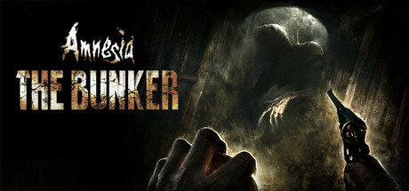

**Amnesia: The Bunker is the most mechanically innovative Amnesia, set in a WWI underground bunker stalked by a single persistent monster that responds to noise. Features a semi-open structure with a fuel-dependent generator and genuine moment-to-moment dread.**

---

## 📖 About

Amnesia: The Bunker is the most mechanically innovative Amnesia, set in a WWI underground bunker stalked by a single persistent monster that responds to noise. Features a semi-open structure with a fuel-dependent generator and genuine moment-to-moment dread.

## ⚠️ Problems Without Trainer

| Problem | Status |
|---------|--------|
| **Noise Sensitivity** — The Beast responds to any sound; even running triggers immediate pursuit | ✅ Solved |
| **Fuel Management** — Generator running out plunges the entire bunker into monster-accessible darkness | ✅ Solved |
| **Inventory Juggling** — Limited storage requires difficult item priority decisions throughout | ✅ Solved |
| **Randomized Elements** — Some item locations change each playthrough making memorization unreliable | ✅ Solved |

## ✅ Solution

The **Amnesia: The Bunker Trainer** solves all these issues by giving you complete control over the game.

## 🎯 Full Feature List

- Unlimited Resources
- God Mode / Invincibility
- Instant Skill Cooldown
- One-Hit Kill
- Freeze Game Timer
- Unlock All Items & Achievements
- Custom Speed Multiplier
- Save State Anywhere

## 🚀 Quick Start

1. **Disable Windows Defender** temporarily (trainer may trigger false positive)
2. Download the trainer from the button above
3. Launch Amnesia: The Bunker
4. Run the trainer as Administrator
5. Activate desired cheats with hotkeys

## 💎 Free vs Paid

| Feature | Free | Pro |
|---------|------|-----|
| Basic God Mode | ✅ | ✅ |
| Unlimited Resources | ✅ | ✅ |
| All Advanced Cheats | ❌ | ✅ |
| Auto-Updates | ❌ | ✅ |
| Priority Support | ❌ | ✅ |

## 💻 Requirements

- Windows 10/11 (64-bit)
- Amnesia: The Bunker (any version)
- .NET Framework 4.8+
- DirectX 11+

## 🍎 macOS

macOS users can use our alternative tool:

## ⚖️ Legal

This trainer is for educational and single-player use only. Use responsibly.

---

